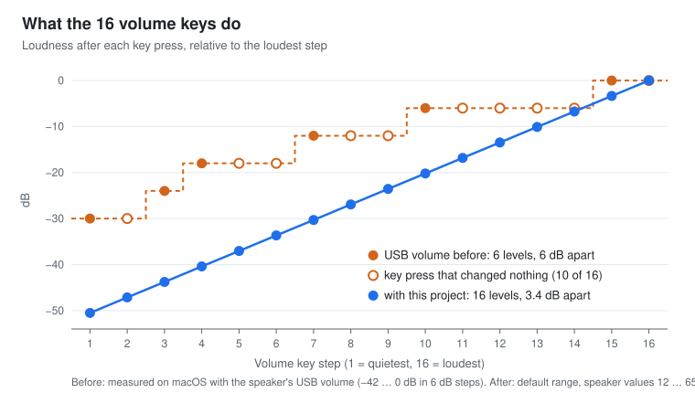
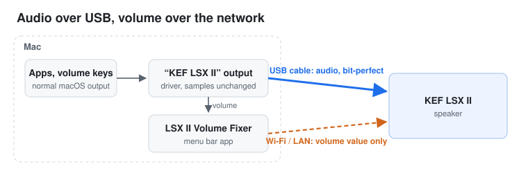
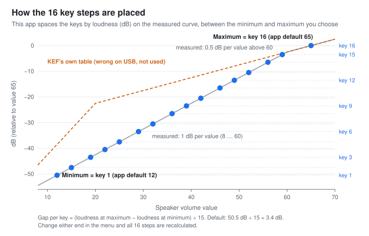
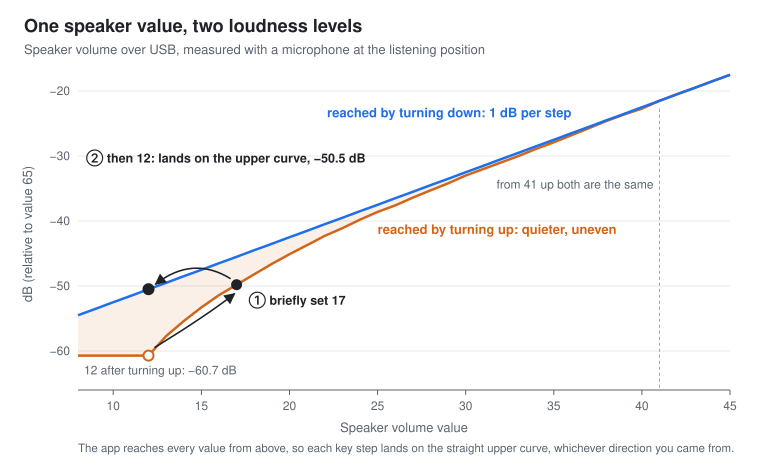

# LSX II Volume Fixer

Fine-grained volume for a **KEF LSX II connected to a Mac over USB**. Out of the box, the Mac's
volume keys only reach 6 loudness levels on this speaker, and most key presses do nothing. With
this project every key press gives a real, equal step: 16 levels, 3.4 dB apart, with the normal
macOS volume HUD. The audio stays on the USB cable, bit-perfect, with about 2 ms of added latency.



- [The problem](#the-problem)
- [What this project does](#what-this-project-does)
- [How the volume keys are mapped](#how-the-volume-keys-are-mapped)
- [Fixing the speaker's volume curve](#fixing-the-speakers-volume-curve)
- [Other things the app takes care of](#other-things-the-app-takes-care-of)
- [Requirements](#requirements) · [Install](#install) · [Settings](#settings) · [Uninstall](#uninstall)
- [FAQ](#faq) · [Windows and other speakers](#windows-and-other-speakers) · [Technical details](#technical-details)

## The problem

Connect an LSX II to a Mac over USB and press the volume keys: the volume jumps in large steps,
and several key presses change nothing at all. The speaker's USB audio interface only offers
6 dB steps (8 positions between −42 and 0 dB). macOS spreads its 16 key steps over those, so you
only ever get 6 distinct levels: −30, −24, −18, −12, −6 and 0 dB. At a desk, the level you want
often lies between two of them.

The limit sits in the speaker firmware, not in macOS. KEF's firmware updates are signed, so it
cannot be patched. KEF Connect's volume settings (limit, step size) do not change the USB
behaviour either.

## What this project does

The speaker has a second, much finer volume: its own volume value from 0 to 100, which the speaker
remote and the KEF Connect app use. It can be set over the local network. This project puts the
Mac's volume keys on that control and leaves the audio on USB:



- A small audio driver adds an output device called "KEF LSX II". macOS treats it like any other
  output, so the volume keys, the HUD, the menu bar slider and per-app routing work as usual.
- The driver passes every sample to the speaker's USB input unchanged: no resampling, no mixing,
  no volume applied to the signal. Output runs at 192 kHz, the LSX II's maximum. The speaker's
  USB volume is held at 0 dB.
- A menu bar app, **LSX II Volume Fixer**, sends the volume to the speaker over the network and
  shows the current speaker value, its dB value, the output, the USB format and the connection.
- Changes made with the speaker remote or KEF Connect show up on the Mac, too.
- Added latency is about 2 ms.

## How the volume keys are mapped

### Speaker value and loudness are not the same thing

The speaker's own volume is a number from 0 to 100, the one the remote and KEF Connect show. That
number is only a position on a scale. How much louder one more unit makes the speaker depends on
where on the scale you are.

Loudness differences are measured in decibels (dB). 3 dB is a small but clearly audible change;
10 dB sounds about twice as loud. A step of 3 dB sounds the same size whether you are at a quiet or
a loud level. A step of 3 speaker units does not: on the LSX II it is 3 dB in the middle of the
scale but only 1.5 dB near the top.

This project therefore places the 16 key steps in dB, not in speaker units. To do that it has to
know how many dB each speaker value really gives, and on this speaker that turned out to be the
hard part. It has [its own chapter](#fixing-the-speakers-volume-curve) below; the mapping itself
comes first.

### What the keys do, before and after

**Without this project:** The Mac's volume keys never touch the speaker's 0–100 volume. They change
the volume of the speaker's USB input, which KEF's firmware only offers in 6 dB steps. You get
6 levels, and 10 of the 16 key presses change nothing ([The problem](#the-problem)).

**With this project:** The keys set the speaker's 0–100 volume, and the app decides where each of
the 16 key steps lands. It spaces them so that every key press changes the loudness by the same
number of dB, based on how loud each value really is. With the default range that is 3.4 dB per
key; the individual steps are 3 to 4 dB because they are rounded to whole speaker values.

For comparison: the first version of this app spread the keys evenly over the speaker values
12–100. The lower keys then jumped about 6 dB each while the upper ones changed only 3 dB.

### Minimum and maximum

You set the range in the menu with two speaker values. The **minimum** is what the first key press
(key 1) gives. The **maximum** is what the last one (key 16) gives. The app's defaults are 12 and
65. Mac volume 0 sets the speaker to 0 and mutes it.



The app then works out the step size:

> step = (loudness at maximum − loudness at minimum) ÷ 15

With the defaults, 12 is 50.5 dB quieter than 65. That gives 50.5 dB ÷ 15 = 3.4 dB per key.
Rounded to whole speaker values, the keys land on 12 15 19 22 25 29 32 36 39 42 46 49 52 56 59 65.
Move either end and the app recalculates all 16 steps. The menu shows the new values and the step
size. A narrower range gives smaller steps.

Why 65 and not 100: the speaker gets very loud above that, so a higher maximum spends most key
steps on levels you never use at a desk. Raise it in the menu if you need more.

### Finer steps and values outside the range

Option+Shift+volume key moves in quarter steps, as on any Mac. Values below the minimum or above
the maximum can still be set with the remote or KEF Connect; the Mac then shows the nearest end of
its scale.

## Fixing the speaker's volume curve

To space the key steps in dB, the app needs to know one thing: how loud is the speaker at each
volume value? We expected to take that from KEF. Instead we had to measure it, and the measurement
turned up three things about the LSX II on USB that the app has to work around. This chapter
explains them one by one and ends with a summary.

### How we measured

We put a measurement microphone at the listening position, played test tones from the Mac and
stepped through every volume value, up and down. Tones from low bass to high treble gave the same
result, so the curve does not depend on frequency. We then checked the rule described below with a
230-step test whose levels were predicted in advance; every step matched within the measurement
scatter. The full data is in [docs/usb-volume-curve.md](docs/usb-volume-curve.md).

### 1. KEF's own volume table is wrong for USB

The speaker publishes a table that says how many dB each volume value gives. It claims 2 dB per
unit below 20 and 0.5 dB per unit above. The microphone says otherwise: on USB it is 1 dB per unit
from 8 to 60 and 0.5 dB per unit from 60 to 65. At value 20 the table is off by 20 dB, at
value 12 still by 12 dB.

**What the app does:** It does not use KEF's table at all. The key steps and the dB value shown in
the menu are based on the measured curve. Nothing on the speaker is changed: value 12 plays exactly
as loud as it always did, the app just knows how loud that is.

### 2. The same value can be louder or quieter

On USB the loudness of a volume value depends on how you got there. Set 20 by turning down from 30,
then set 20 by turning up from 10: the second time the speaker is 2.6 dB quieter, at the same
displayed value. At 12 the difference is 10 dB. From 41 up there is none. So below 41 the speaker
has two volume curves: a louder, straight one for values reached by turning down, and a quieter,
uneven one for values reached by turning up. This is how the speaker's firmware behaves; macOS and
this app play no part in it.



Left alone, this breaks equal steps. In our measurement, going up from 12 to 17 changed the
loudness by less than 1 dB, and the next step, 17 to 23, by almost 9 dB. And the same key sounded
louder after turning down than after turning up.

**What the app does:** The measurements showed a simple pattern. Raising the value never makes the
speaker quieter, and lowering it never makes it louder. The app uses that. When the volume goes up,
it sets a value slightly above the target for 0.1 s and then the target itself. The speaker
arrives at the target from above, on the straight curve the key steps are based on. Example: key
up to 12 → the app sends 17, then 12. For those 0.1 s the speaker is at most about 1 dB louder,
too short to hear as a step. Turning down needs no trick, because it already comes from above.

Result: every key step sounds the same whichever direction you came from.

### 3. Above 60 the curve flattens

From 60 to 65 each unit adds only 0.5 dB, half as much as below 60.

**What the app does:** Because it spaces the keys by dB and not by units, it simply gives the last
key more units: 59 → 65 is 6 units, which is 3.5 dB, about as big as every other step.

### In short

| | KEF's firmware on USB | This project |
| --- | --- | --- |
| What the Mac's keys change | The USB input volume: 6 dB steps, 6 levels | The speaker's 0–100 volume: 16 steps of 3.4 dB |
| How loud each value is | A published table, up to 20 dB off | The curve we measured |
| Same value, same loudness? | No, up to 10 dB apart below 41 | Yes, every value is reached from above |
| Above 60 | Only 0.5 dB per unit | The last key spans more units |

## Other things the app takes care of

### After a USB reconnect

Waking from standby or reconnecting the cable makes the LSX II disappear from USB and come back.
Several things used to go wrong then; the app now handles them:

- macOS switched the output to the internal speakers and never switched back. The app restores
  "KEF LSX II" as output, unless you deliberately picked something else, such as AirPods.
- The speaker sometimes reset its own volume. A jump of 25 or more without a change on the Mac is
  treated as a reset, and the Mac's value is sent again.
- The USB device could come back at a lower sample rate. The app pins it to 192 kHz / 24-bit, and
  the virtual device only offers 192 kHz, so nothing can lower it.
- When the Mac plays audio for 2 s while the speaker is in standby, the app wakes it and selects
  the USB input. It never switches away from another source that is playing.

### Several users on one Mac

Driver and app are installed for all users. Each logged-in user gets their own instance, and only
the one at the screen talks to the speaker. After a user switch the app opens a fresh network
connection, because once every request kept failing until the app was restarted; if the speaker is
still unreachable two minutes later, the app restarts itself.

## Requirements

- **The LSX II on USB *and* on the same network as the Mac** (Wi-Fi or Ethernet). USB carries the
  audio; the network carries the volume.
- macOS 14 or later (developed and tested on macOS 27), Apple silicon or Intel.
- Xcode Command Line Tools (`xcode-select --install`) for `clang++`, `swiftc` and `codesign`.
- An administrator account: driver and app are installed system-wide.

## Install

```bash
git clone https://github.com/roberdorfer/kef-lsx-volume.git
cd kef-lsx-volume
make test
scripts/install.sh all      # one admin password prompt; restarts the audio system briefly
```

When macOS asks whether "LSX II Volume Fixer" may find devices on your local network, allow it.
After that, "KEF LSX II" is your sound output and the volume keys control the speaker.

There are no prebuilt binaries: `install.sh` builds from source on your Mac and signs ad hoc
(`codesign --sign -`), so no downloaded app has to pass Gatekeeper.

More options:

```bash
scripts/install.sh all --dry-run   # builds and prints the admin script; installs nothing
scripts/install.sh all --pref maxSpeakerVolume=60   # plus a system-wide default for all users
```

Installs `/Library/Audio/Plug-Ins/HAL/KEFProxy.driver`, `/Applications/LSXIIVolumeFixer.app`
and `/Library/LaunchAgents/io.github.roberdorfer.lsxiivolumefixer.plist`. Users who are logged in
get the new version right away; others at their next login.

### Install with an AI coding agent

Paste this into Claude Code, Codex or a similar agent running on the Mac:

```text
Install kef-lsx-volume (https://github.com/roberdorfer/kef-lsx-volume) on this Mac. It makes the
Mac volume keys control a KEF LSX II connected over USB in fine steps.

1. Check the prerequisites and stop with a clear explanation if one is missing:
   - macOS 14 or later (`sw_vers -productVersion`).
   - Xcode Command Line Tools (`xcode-select -p`). If missing, ask me to run
     `xcode-select --install` and wait.
   - The LSX II is connected over USB: `system_profiler SPAudioDataType` lists an "LSX II" device.
   - The LSX II is on the same network: `dns-sd -B _http._tcp local.` (stop it after ~5 s) shows
     a service named "LSX II" or a host starting with "lsxii-". If not, ask me to check that the
     speaker and the Mac are on the same network.
2. Clone the repository into a folder of my choice (ask if unsure), then run `make test` and show
   me the result.
3. Run `scripts/install.sh all --dry-run` and summarise what will be installed.
4. Tell me that the next step asks for my administrator password and restarts macOS audio for a
   moment, then run `scripts/install.sh all`. I type the password myself; never ask me for it.
5. Tell me to allow "LSX II Volume Fixer" when macOS asks about devices on the local network.
6. Verify:
   - `launchctl print gui/$(id -u)/io.github.roberdorfer.lsxiivolumefixer` shows the agent running.
   - `~/Library/Logs/LSXIIVolumeFixer.log` shows "proxy device:" and no "no LSX II found via
     Bonjour" line after the permission was granted (if there is one, ask me to enable the app under
     System Settings → Privacy & Security → Local Network, then choose "Restart" in its menu).
   - "KEF LSX II" is the default output in System Settings → Sound.
7. Ask me to press the volume keys once and confirm that the speaker follows. Do not play test
   sounds or change the volume yourself.

Do not change other system or security settings. To remove everything later:
`scripts/uninstall.sh` (add `--purge` to also delete my settings and log).
```

## Settings

All settings are in the menu bar menu. They can also be set with
`defaults write io.github.roberdorfer.lsxiivolumefixer <key> <value>`.

Per-user values live in the user's own defaults. A system-wide default for all users goes into
`/Library/Preferences/io.github.roberdorfer.lsxiivolumefixer.plist`; "Apply these settings for all
users…" in the menu writes the current user's values there (admin prompt), as does
`scripts/install.sh --pref key=value`. A user's own value overrides the system-wide one.

| Key | Default | Meaning |
| --- | --- | --- |
| `speakerHost` | *(empty: Bonjour)* | Optional fixed hostname / IP of the speaker. By default the app finds the LSX II itself via Bonjour (`_http._tcp` service "LSX II", host `lsxii-<mac>.local`) |
| `minSpeakerVolume` / `maxSpeakerVolume` | `12` / `65` | Speaker value of the first (1/16) and of the last key step; Mac 0 = speaker 0 + mute |
| `autoSwitchDefault` | `true` | Keep/restore the proxy as default output |
| `autoWakeOnPlayback` | `true` | When the Mac plays audio for ≥ 2 s while the speaker is in standby, wake it and select USB (other active sources are never switched) |
| `showVolumeInMenuBar` | `true` | Show the speaker volume next to the menu bar symbol |
| `resetJumpThreshold` | `25` | Speaker jump treated as a speaker-side reset |
| `restoreInputUIDPrefix` | unset (off) | Optional: device-UID prefix of an input device (e.g. a USB mic on the same hub) whose default-input role is restored after a USB re-enumeration. Unrelated to the speaker; opt-in. |
| `defaultOutputSetFor` | set by the app | UID of the proxy device that was made the default output once for this user. Delete it to redo that step. |

With the default 12–65 range the 16 key steps are the speaker values
12 15 19 22 25 29 32 36 39 42 46 49 52 56 59 65; the menu shows the values for your range and the
step size. Values below the minimum or above the maximum can still be set with the remote or the
KEF app; the Mac then shows the nearest end of its scale.

Log: `~/Library/Logs/LSXIIVolumeFixer.log` of the user the instance runs as ("Open log" in the menu).

## Uninstall

```bash
scripts/uninstall.sh            # one admin password prompt; restarts the audio system briefly
scripts/uninstall.sh --purge    # also deletes your own settings and log
scripts/uninstall.sh --dry-run  # prints what would be removed; removes nothing
```

Stops the app in every logged-in session and removes the driver, the app, the LaunchAgent plist
and the system-wide prefs. macOS then picks another output. Other users keep their own settings;
for them the proxy is not made the default output again after a reinstall (delete
`defaultOutputSetFor` in their defaults, or pick "KEF LSX II" once). The app's entry under
Privacy & Security → Local Network stays, because macOS offers no way to remove it; it has no
effect once the app is gone.

## FAQ

**Does the music go over Wi-Fi?**
No. The audio goes over USB, sample for sample. Only the volume value uses the network.

**Is it still bit-perfect if the volume is set in the speaker?**
Yes, as far as the Mac is concerned: the driver applies no volume, no dithering and no sample-rate
conversion, and the USB volume stays at 0 dB. Mute is the one exception: it sends silence. Sources
below 192 kHz are converted to 192 kHz by macOS before they reach the driver, as with any fixed-rate
output.

**How much latency does it add?**
About 2 ms: the driver's buffer and safety margin (274 samples at 192 kHz) plus the USB device's
own lead. The driver's timing statistics showed no dropouts at that setting.

**What happens without the network?**
Audio keeps playing over USB, but the volume keys cannot change the speaker volume until the
network is back.

**The keys do nothing and the menu has no "Speaker:" line.**
The app finds the speaker over the local network. If the macOS question about devices on the
local network was answered with "Don't Allow", the speaker is never found. Turn "LSX II Volume
Fixer" on under System Settings → Privacy & Security → Local Network, then choose "Restart" in the
app's menu. "Open log" shows the reason: a line saying that no LSX II was found via Bonjour.

**Why not just use the speaker remote or KEF Connect?**
You can, and the Mac follows those changes. This project is for people who want the keyboard,
the HUD and app volume control on the Mac.

**Why not Background Music, SoundSource or similar?**
They scale the audio signal on the Mac, so playback is no longer bit-perfect, and you end up with
two volume controls. Here the signal stays untouched and the speaker sets the volume.

**What if a KEF firmware update changes the curve?**
Then the steps may become uneven again and the curve needs to be measured again. The measurement
method is in [docs/usb-volume-curve.md](docs/usb-volume-curve.md).

**How do I remove it?**
`scripts/uninstall.sh`. See [Uninstall](#uninstall).

## Windows and other speakers

This project is macOS only, and only the LSX II is tested. We expect the same approach to work on
Windows with the same features: the coarse USB volume is in the speaker firmware, and the network
volume control does not care which computer sends it. A Windows version would need a virtual audio
device that forwards to the LSX II's USB output and a small tray app for the volume. The measured
curve, the step placement and the approach-from-above logic in `Helper/Config.swift` carry over
unchanged. If you want to build that, or adapt it to another KEF speaker, feel free to fork the
project.

## Technical details

- `Driver/KEFProxyDriver.cpp` is a CoreAudio HAL AudioServerPlugIn that publishes a virtual
  output device "KEF LSX II" (UID `io.github.roberdorfer.kefproxy.device`) with a fine volume
  control. The HAL mixes into the proxy; the driver copies the samples unchanged into a ring buffer
  that the real USB device's IOProc (running inside coreaudiod) drains. No resampling: the virtual
  clock is a line fitted to the real device's IOProc timestamps. The proxy offers exactly one
  format, 192 kHz / 32-bit float, and forces the USB device back to 192 kHz if anything else
  changes its rate.
- `Helper/` is the menu bar app (`/Applications/LSXIIVolumeFixer.app`, LaunchAgent
  `io.github.roberdorfer.lsxiivolumefixer`). It mirrors the proxy's volume to the speaker
  (`POST /api/setData player:volume`), mirrors remote/app changes back, pins the USB host volume at
  0 dB and the USB format at 192 kHz / 24-bit, and keeps the proxy as the default output.

Added latency = virtual safety offset + real output path. At 192 kHz: safety 50 + 2×64 buffer +
500 µs jitter reserve (96 frames) = 274 frames, plus ≈113 frames real device lead, roughly 2 ms.

Tuning at runtime (no reinstall; persisted by the driver): custom property `'kcfg'` on the device,
string `buffer=N;jitterUs=M`. Stats in `'kstt'`, a ring trace of host writes (`W`) and real IOProc
callbacks (`R`) in `'ktrc'`.

Notes for anyone changing the driver:

- The HAL caches a device's SafetyOffset/Latency when the device is published, so the driver
  requests a device configuration change after every config edit.
- `outSeed` of GetZeroTimeStamp must stay constant while IO runs; bumping it per period makes the
  HAL resynchronise every cycle (≈8 ms stalls, dropped blocks).

The figures are generated by `scripts/make_figures.py` from the measured data.

## Disclaimer

This is an independent project, not affiliated with or endorsed by KEF. KEF and LSX are
trademarks of their respective owner. The driver runs inside `coreaudiod`, the macOS audio
server: a bug in it can interrupt all audio on the Mac until the driver is removed
(`scripts/uninstall.sh`). Use it at your own risk; the software comes without warranty
(see the license).

## License

MIT, see [LICENSE](LICENSE).
